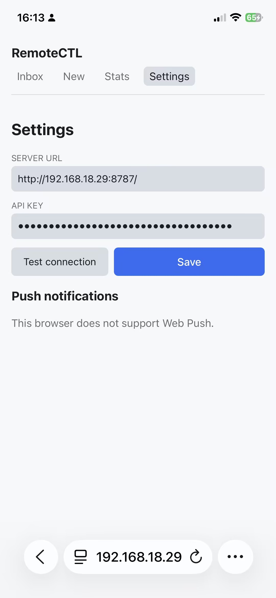
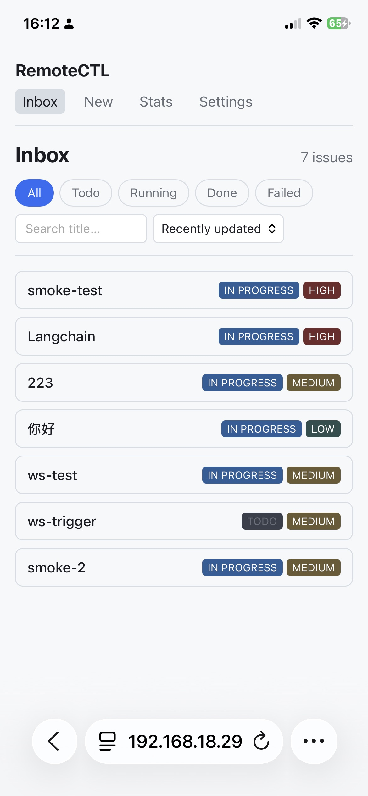
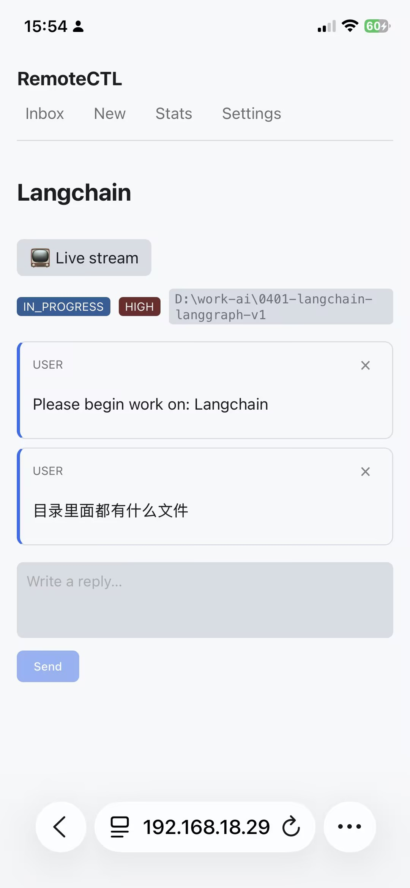
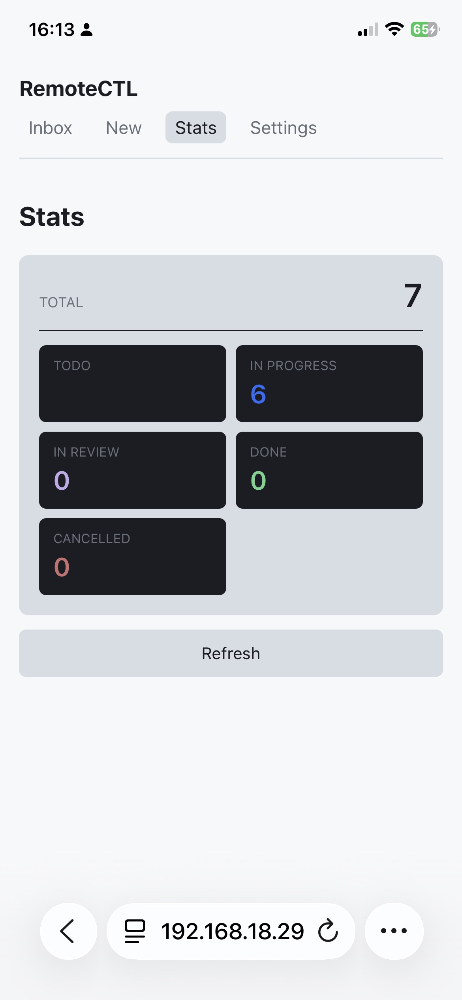
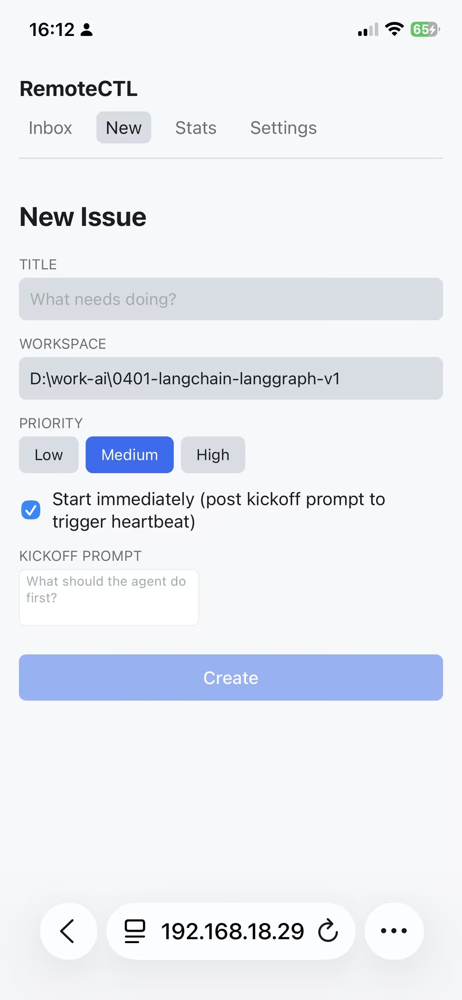

# remotectl

手机端控制 Claude Code 的伴侣 App。一个轻量 Node 服务提供 REST + WebSocket API,前端是 Capacitor 打包的 React 应用;任务由 `claude` CLI 驱动,状态通过单一 WebSocket 实时同步。

## 架构

仓库是一个 pnpm workspace,三个包:

| 包 | 作用 |
| --- | --- |
| `server` (`@remotectl/server`) | Express + `ws` API (HTTP `:8787`,WS `:8788`),SQLite via `libsql`/Drizzle,推送通知管线,调度器。v0.1 仅监听 loopback。 |
| `cli` (`@remotectl/cli`) | `remotectl` 命令。生成 API key、跑迁移、上传数据,启动服务并打印 token。 |
| `app` (`@remotectl/app`) | React + Vite SPA,通过 Capacitor 打包为 iOS/Android。Settings → Server URL + API Key;实时收件箱和问题详情。 |

启动流程: `remotectl start` → CLI 打开 SQLite → 生成/加载 API key → 实例化 `createApp()` → 打印 `HTTP` / `WS` / `Token` 三行。

## 快速开始

详见 **[docs/SETUP.md](docs/SETUP.md)** — 前置依赖 (Node 22+、pnpm 9、Claude Code、Tailscale)、Tailscale 配置、完整的克隆安装步骤、以及如何把手机连上工作站。

简版:

```bash
git clone <repo> remotectl
cd remotectl
pnpm install
pnpm --filter @remotectl/cli build
remotectl start   # 打印: HTTP, WS, Token
```

## 核心功能

| 功能 | 描述 |
| --- | --- |
| **实时收件箱** | WebSocket 推送 issue 创建/状态变化,断线自动重连并补发错过的 event。 |
| **流式日志** | 问题详情页实时显示 Claude `stream-json` 输出,支持取消。 |
| **审批流** | Claude 请求确认时手机弹卡片,点 yes/no 直接喂回 stdin。 |
| **Web Push** | VAPID 推送:iOS Safari 16.4+ (添加到主屏后)、Android Chrome。 |
| **PWA** | 可 "Add to Home Screen",离线打开,manifest + Service Worker。 |
| **iOS 原生** | Capacitor 打包为独立 App,通过 APNs 收推送 (v0.2 才完整联通)。 |
| **重启恢复** | WS `?since=` cursor + 持久化 broadcast_log + 重连后 replay。 |

## 截图

四个页面 + 推送订阅,手机 Safari / Android Chrome 直连工作站:

### Inbox — 实时收件箱

所有任务按状态分桶 (All / Todo / Running / Done / Failed),支持标题搜索与排序。WebSocket 推 issue 创建和状态变化,断线重连后用 `?since=` cursor 补发错过的 event。



### New Issue — 一键起任务

填标题、workspace、优先级 (Low / Medium / High),可勾选 "Start immediately" 让服务端在创建后立刻跑 kickoff prompt 触发心跳,或者只入队等会儿手动起。Kickoff prompt 是给 Claude 的第一句指令。



### Issue Detail — 流式日志 + 审批

服务端调 `claude --output-format stream-json`,每一行 stdout 立刻推到这条 issue。Live stream 按钮可取消运行。审批请求 (Claude 在交互模式下问 yes/no) 走同一频道,手机点卡片直接喂回 stdin。



### Stats — 当前排队概况

一眼看出还有多少 TODO / IN PROGRESS / IN REVIEW / DONE / CANCELLED,Refresh 拉最新计数。



### Settings — 服务端地址 + Web Push 订阅

填 Server URL (推荐 Tailscale IP,如 `http://100.x.y.z:8787/`) 和 API Key (服务端 `remotectl start` 时打印的 token)。Save 后浏览器请求 Web Push 权限,订阅成功后服务端就能把审批/状态变化推到这台手机。Web 版在 iOS Safari 上要先 "Add to Home Screen" 才支持推送,Android Chrome 直接可用。



## 开发

仓库根目录:

```bash
pnpm install   # 安装所有 workspace 依赖
pnpm dev       # 并行执行各包的 dev 脚本
pnpm build     # 构建所有包
pnpm test      # 跑所有测试
```

单个包:

```bash
pnpm --filter @remotectl/server dev       # tsx watch
pnpm --filter @remotectl/server test      # vitest
pnpm --filter @remotectl/server build
pnpm --filter @remotectl/cli dev          # tsx (无需 build)
pnpm --filter @remotectl/cli build
pnpm --filter @remotectl/app dev          # vite dev server (端口 5173)
pnpm --filter @remotectl/app build        # 构建到 ./dist (Capacitor webDir)
pnpm --filter @remotectl/app test         # vitest
```

## iOS 原生打包

Capacitor 把构建好的 SPA 包成原生壳。Web 资源和 Capacitor 配置是跨平台的;iOS 壳必须在 macOS + Xcode 下生成。

### 一次性初始化 (仅 Mac)

```bash
pnpm --filter @remotectl/app install
pnpm --filter @remotectl/app ios:add       # 调 cap add ios,生成 ./ios/
```

### 每次 Web 改完后同步进 Xcode 工程

```bash
pnpm --filter @remotectl/app ios:build     # vite build + cap sync ios
```

### 在 Xcode 里跑 (设备或模拟器)

```bash
pnpm --filter @remotectl/app ios:open      # 打开 Xcode
```

### iOS 推送通知

Web 版走 Web Push (VAPID),iOS 原生版走 APNs via `@capacitor/push-notifications`:

1. **Apple Developer 配置**: 在 App ID 上启用 Push Notifications capability,在 App Store Connect 创建一个 APNs auth key (.p8)。
2. **注册原生插件**: 在 `ios/App/App/AppDelegate.swift` 里按 [Capacitor Push 文档](https://capacitorjs.com/docs/plugins/push-notifications) 注册插件。v0.1 阶段 App 拿到 APNs device token 后 POST 到服务端的 `/api/push/devices` endpoint,带 `platform: "ios"` — 服务端只入库,暂不真正派发 APNs (服务端 APNs sender 是 v0.2)。
3. **隐私文案**: 如要展示应用内横幅,在 `ios/App/App/Info.plist` 加 `NSUserNotificationUsageDescription`。

Web 版不依赖任何 Apple Developer 配置 — 用 `pnpm --filter @remotectl/app build` 出 PWA,iOS 16.4+ 直接 Safari 添加到主屏就能用推送。

### Windows / Linux 注意

`cap add ios` 和 `cap open ios` 只能在 macOS 上跑。Windows / Linux 上可以装依赖 (`pnpm install`)、构建 Web (`pnpm --filter @remotectl/app build`)、同步已生成的 `ios/` 文件夹 (`pnpm --filter @remotectl/app exec cap sync ios`)。最终的代码签名和真机安装仍然需要 Mac。

## 仓库结构

```text
remotectl/
├── package.json             # workspace 根, pnpm@9
├── pnpm-workspace.yaml
├── tsconfig.base.json
├── docs/
│   └── SETUP.md             # 端到端安装指南
├── server/
│   ├── src/                 # Express app, ws, push, scheduler, db
│   │   ├── adapter/claude.ts        # 调 claude CLI 的 adapter
│   │   ├── routes/                  # REST handlers
│   │   ├── ws/                      # WebSocket 广播 + 重连 replay
│   │   ├── push/                    # VAPID 推送派发
│   │   └── scheduler/               # runner + PendingApprovals 注册表
│   └── data/                # 本地 SQLite (gitignored)
├── cli/
│   ├── src/commands/        # `start`, `token`
│   └── dist/                # 构建产物 (./dist/index.js → `remotectl`)
└── app/
    ├── src/                 # React SPA
    │   ├── pages/           # Inbox / IssueDetail / Settings / Stats / NewIssue
    │   ├── components/      # LiveStream / ApprovalCard / IssueRow
    │   ├── api/             # ApiClient + WebSocket 客户端
    │   └── push.ts          # Web Push + Capacitor native push 双路径
    ├── public/              # PWA 静态资源 (manifest, sw.js, icon)
    ├── capacitor.config.json
    └── vite.config.ts
```

## 配置

CLI 读取以下环境变量 (括号内为默认值):

| 环境变量 | 默认值 | 用途 |
| --- | --- | --- |
| `PORT` | `8787` | HTTP 监听端口 |
| `WS_PORT` | `8788` | WebSocket 监听端口 |
| `DB_PATH` | `~/.remotectl/server.db` | SQLite 路径 |
| `CLAUDE_BINARY` | `claude` | Claude Code CLI 路径 |

服务端还会从 `server/src/config.ts` 读 adapter 路径 (`claude` + `--dangerously-skip-permissions --output-format stream-json`) 和默认 workspace 根目录 (`$HOME/code`)。

## 故障排查

| 现象 | 可能原因 |
| --- | --- |
| 手机连不上服务端 | 服务默认仅监听 loopback;用 Tailscale 暴露 100.x IP,或在 `PORT` 上绑 `0.0.0.0`。 |
| Web Push 没收到 | iOS Safari 必须先 "Add to Home Screen" 才支持推送;Android Chrome 直接可用。 |
| 审批 yes/no 无效果 | 当前 `claude` 用 `--print` 模式,不会真在 stdin 上暂停;审批路由已通但只在 interactive 模式下生效 (v0.2)。 |
| iOS build 失败 (Windows) | `cap add ios` 必须 Mac,在 Windows 上只跑 `cap sync ios` 同步已存在的 `ios/`。 |

## 开发路线

- **v0.1 (当前)**: Web Push 全链路通,iOS 端只存 APNs token 不派发。
- **v0.2**: 服务端 APNs 派发 + Codex/Cursor adapter + 审批真生效 (interactive mode)。
- **v0.3**: Android 原生壳 + 多账号 / 多 workspace。

## 许可证

MIT.
